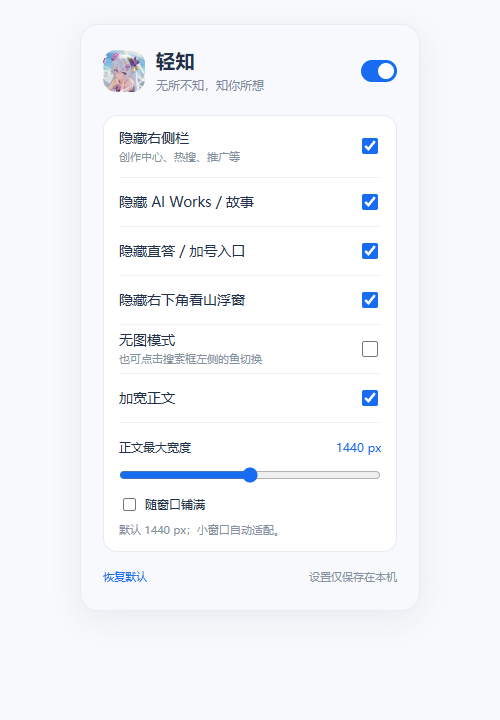
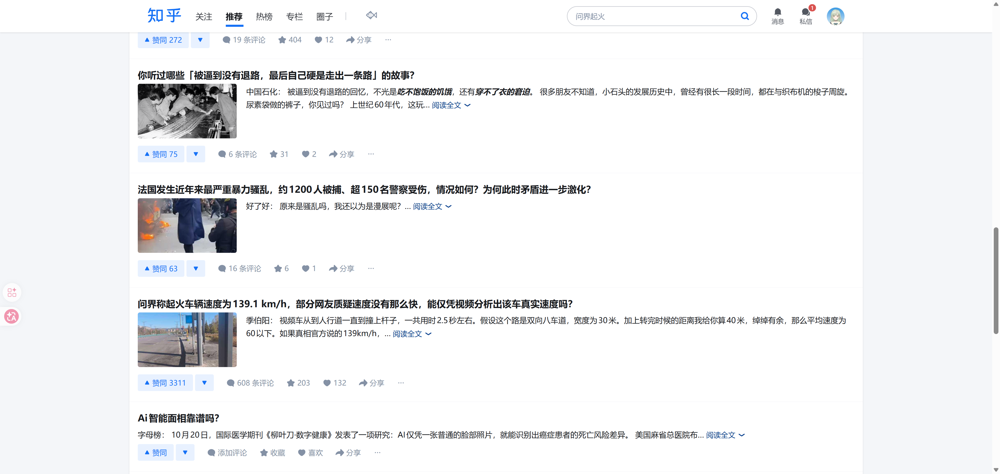
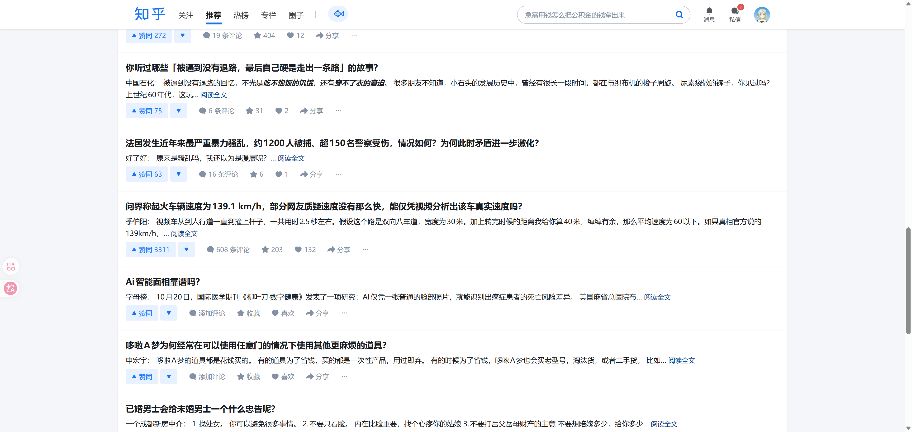

# 轻知

**无所不知，知你所想**

一个轻量的 Chrome 扩展，让知乎的阅读界面更清爽。收起侧栏和多余入口，给正文更多空间；点击搜索框左侧的小鱼，即可切换无图模式。

## 功能

- **简化页面**：隐藏创作中心、热搜、推广侧栏，以及 AI Works、故事、直答和顶部加号入口。
- **收起浮窗**：隐藏右下角带「Hi」的看山入口，保留回到顶部按钮。
- **加宽正文**：正文居中，默认最大宽度为 1440 px，可调整至 960–1920 px，也可随窗口铺满。
- **小鱼开关**：点击搜索框左侧的鱼，收起图片、封面、视频和背景图片，再点恢复。
- **保留头像**：无图模式下，个人、作者和评论头像仍然显示。
- **记住偏好**：设置保存在本机，后续打开页面会继续使用；各项功能可单独开关。

关注、推荐、热榜、专栏、圈子、搜索、消息、私信及正文操作保持可用，首页「分享此刻的想法」区域保留。

## 截图

### 设置面板



### 阅读布局



### 无图模式



阅读布局和无图模式均为用户提供的知乎实页截图；设置面板截图来自当前版本的本地渲染。

## 安装

无需编译，也不需要安装项目依赖。

1. 下载或克隆本项目；如果使用 ZIP，请先解压。
2. 在 Chrome 地址栏输入 `chrome://extensions`。
3. 打开右上角的「开发者模式」。
4. 点击「加载已解压的扩展程序」。
5. 选择项目中的 `extension` 文件夹，确认该文件夹内有 `manifest.json`。
6. 刷新已打开的知乎页面。

可在 [GitHub Releases](https://github.com/SokiSama/Qingzhi/releases/latest) 下载打包好的 `轻知-1.1.1.zip`。压缩包包含扩展、README 和完整截图；解压后请选择 `轻知/extension` 文件夹加载。ZIP 文件本身不能直接通过「加载已解压的扩展程序」安装。

可在 Chrome 右上角的扩展菜单中固定「轻知」，方便打开设置面板。

## 使用

| 操作 | 方法 |
| --- | --- |
| 切换无图模式 | 点击知乎搜索框左侧的小鱼；蓝色表示已开启 |
| 恢复图片 | 再次点击小鱼，无需刷新页面 |
| 调整正文宽度 | 打开扩展面板，开启「加宽正文」并拖动滑块 |
| 随窗口铺满 | 在扩展面板中勾选「随窗口铺满」 |
| 调整隐藏项目 | 在扩展面板中分别开关侧栏、导航、入口和浮窗 |
| 暂时恢复原页面 | 关闭扩展面板右上角的总开关 |
| 恢复初始设置 | 点击扩展面板底部的「恢复默认」 |

窗口较窄时，正文宽度会自动适配。宽度以 CSS 像素计算，浏览器缩放会影响实际显示效果。

## 更新

将新版文件覆盖到原先加载的扩展目录，然后在 `chrome://extensions` 中点击「轻知」卡片上的重新加载按钮，最后刷新知乎页面。

覆盖原目录并重新加载，可保留已有设置。从「知乎净化」旧版升级时同样适用。

## 权限与隐私

- 仅在 `www.zhihu.com`、`zhihu.com` 和 `zhuanlan.zhihu.com` 的 HTTPS 页面运行。
- 仅申请 `storage` 权限，用于保存本机偏好。
- 扩展不发送网络请求，不收集或上传浏览内容，无需账号、API 密钥或服务端。
- 无图模式控制页面显示，不主动阻止图片或视频资源下载。

## 适配范围

主要适配知乎首页，同时包含问题页、搜索页和专栏正文的常见布局规则。

知乎更新页面结构后，部分规则可能需要调整。遇到显示问题，可先关闭对应功能或总开关；反馈时附上页面类型、扩展版本及截图，有助于定位。

已通过本地 Chrome 不同窗口宽度下的布局与交互回归测试；尚未在已登录知乎的实时首页完成全面验证。

## 开发

使用原生 JavaScript、CSS 和 Manifest V3，无构建步骤、无外部运行依赖。

```text
extension/                 可直接加载的扩展
  manifest.json            扩展信息与权限
  content.js               页面识别、小鱼按钮及设置同步
  clean.css                页面布局与无图模式样式
  settings.js              默认设置与校验
  popup.html / css / js    设置面板
  icons/                   扩展图标
docs/images/               README 截图
scripts/capture-docs.mjs   生成设置面板截图
scripts/package.ps1        打包扩展、README 与截图
tests/                     本地模拟页面与回归检查
```

安装 Node.js 后，可在项目根目录运行：

```sh
node tests/verify.mjs
node tests/browser.mjs
```

浏览器测试使用项目内的独立 Chrome 配置，不读取日常浏览器资料。脚本默认使用 Windows 上的常见 Chrome 安装路径，可通过 `CHROME_PATH` 环境变量指定其他路径。

重新生成设置面板截图（保留用户提供的阅读布局和无图模式截图）：

```sh
node scripts/capture-docs.mjs
```

修改扩展代码后，重新加载扩展并刷新知乎页面即可查看效果。

在 PowerShell 中重新打包：

```powershell
./scripts/package.ps1
```

打包结果保存在 `dist`，同时生成 SHA-256 校验文件。下载包内保留 README 的相对图片路径，解压后可离线查看截图。

## 更新记录

### 1.1.1

- 名称调整为「轻知」，简介改为「无所不知，知你所想」。
- 更新扩展图标、工具栏图标和设置面板头像。
- 无图模式保留个人、作者和评论头像。

### 1.1.0

- 新增搜索框左侧的小鱼按钮与可记忆的无图模式。
- 新增看山浮窗隐藏选项。

### 1.0.1

- 补充侧栏识别，修复正文加宽后侧栏仍显示并覆盖正文的问题。
